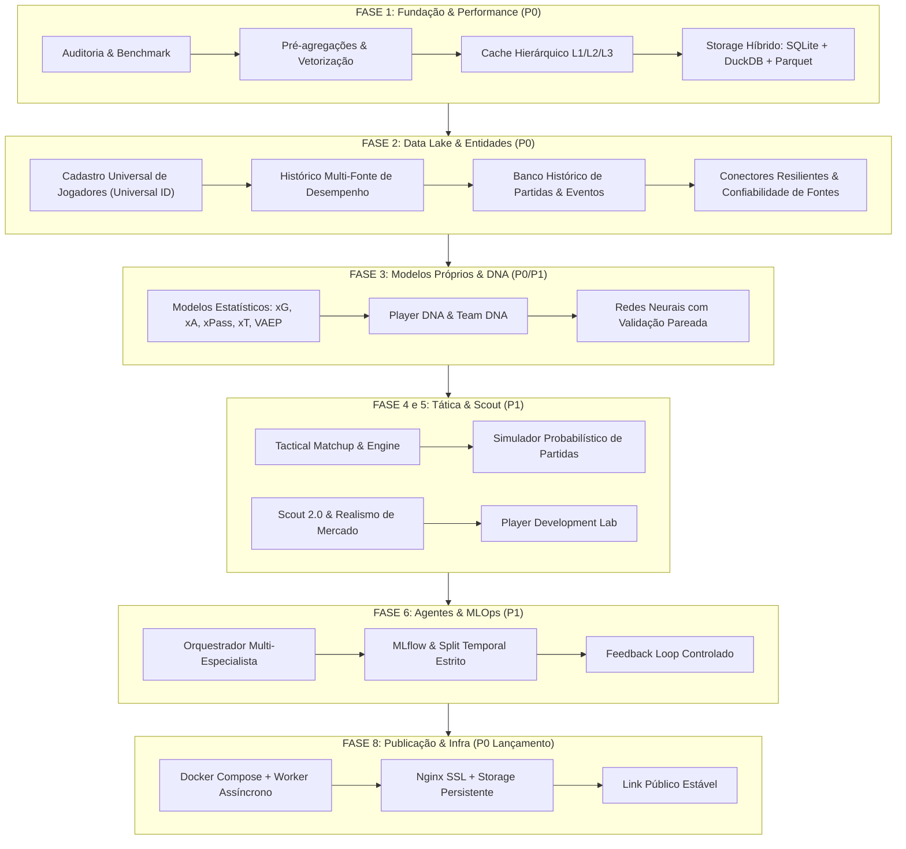
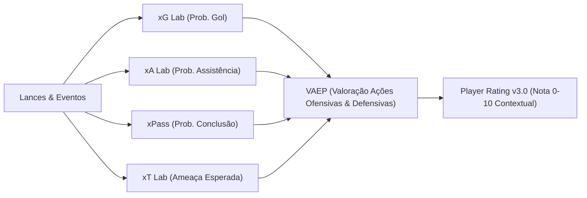
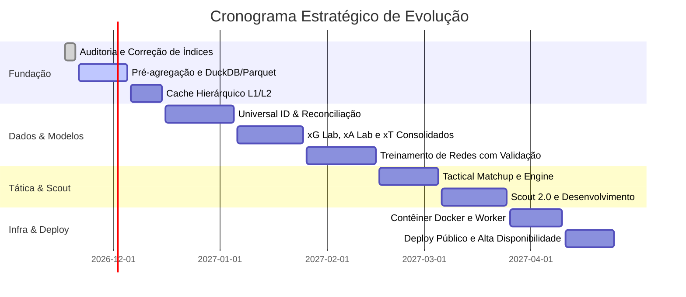

# Plano Diretor de Evolução — Tactical Intelligence Lab
**Repositório:** `garrinchaps/tactical-intelligence-lab`  
**Versão:** 1.0 (Consolidado)  
**Data:** 17 de novembro de 2026  
**Ambiente:** Python 3.15 · Streamlit · SQLite + DuckDB + Apache Parquet · PyTorch / Scikit-Learn  

---

## Sumário Executivo

O **Tactical Intelligence Lab** foi idealizado para ser uma plataforma autônoma, profissional e explicável de inteligência futebolística. O projeto combina engenharia de dados em larga escala, modelagem estatística contextual, redes neurais para leitura de dinâmicas de jogo, simulação tática e motor de scout auditável.

Este **Plano Diretor** reúne, organiza e prioriza todas as diretrizes técnicas, arquiteturais e metodológicas para conduzir o projeto ao estado da arte internacional, respeitando os recursos de hardware locais (Intel i7-4770, GTX 1070 8 GB, 16 GB RAM) e garantindo uma transição fluida para publicação em nuvem de alta disponibilidade.



---

## 1. Princípios Centrais Inegociáveis

Todas as decisões arquiteturais e linhas de código devem honrar quatro pilares:

### 1.1 Velocidade
* **SLA de Leitura:** Navegação entre páginas com cache $\le 1\text{ s}$; busca e dossiê de jogador $\le 1\text{ s}$; ranking de scout filtrado $\le 3\text{ s}$; inferência estatística $\le 1\text{ s}$.
* **Assincronismo:** Tarefas de longa duração (treinamento de modelos, sincronização externa pesada, reprocessamento global) são despachadas para processos ou workers dedicados em segundo plano, **nunca** bloqueando a interface principal do Streamlit.
* **Operações Vetorizadas:** Eliminação total de iterações linha a linha (`iterrows`, loops em Python sobre dataframes); uso exclusivo de NumPy e Pandas vetorizado, DuckDB e SQL nativo com índices cobertos.

### 1.2 Precisão
* **Honestidade Técnica Inegociável:** Nunca inventar dados. Lacuna na fonte de dados é exibida como lacuna (`None` ou `"não observado"`), nunca convertida silenciosamente em zero.
* **Incerteza Explícita:** Toda estimativa, projeção e previsão apresenta seu grau de confiança, intervalo plausível ou penalidade por escassez de amostra (ex.: encolhimento bayesiano / shrinkage).
* **Calibração e Baselines:** Nenhum modelo sofisticado ou rede neural é promovido para produção se não superar um modelo clássico de referência (Regressão Logística, Ridge, HistGradientBoosting / LightGBM) em validação cruzada com divisão por partida (`GroupKFold` ou temporal).

### 1.3 Cobertura
* **Consolidação Inteligente:** Deduplicação de partidas entre fontes (StatsBomb, FotMob, ESPN, Transfermarkt, OpenPlay, CBF, etc.) por data $(\pm 1\text{ dia})$ e identidades dos clubes.
* **Preservação de Divergências:** Quando duas fontes discordam sobre um número de lance, a discrepância é registrada (`source_divergences`), nunca transformada em média artificial.
* **Identidade Unificada:** Normalização fonética e estrutural de nomes (`player_core`), combinada com data de nascimento e clubes documentados, separando estritamente homônimos ambíguos.

### 1.4 Aprendizado
* **Reprodutibilidade:** Pipelines de dados e treinamento com seeds determinísticos, versionamento de datasets e rastreamento de hiperparâmetros.
* **Sem Vazamento do Futuro (*Data Leakage*):** Separação estritamente cronológica entre conjuntos de treino e teste para predições temporais.
* **Evolução Auditável:** O aprendizado por feedback humano ajusta filtros e pesos explicáveis, sem disparar retreinos não supervisionados de caixas-pretas em produção.

---

## 2. Auditoria Técnica do Estado do Repositório

**Nota de evidência:** este quadro mistura evidências do código consultado no GitHub com uma fotografia histórica do banco local registrada em auditoria anterior. O arquivo `database/tactical_lab.db` não estava disponível nesta sessão; portanto, tamanho, número de tabelas/registros e integridade SQLite abaixo **não são uma certificação atual**. Revalidar no computador que contém o banco usando `python scripts/project_audit.py --database database/tactical_lab.db --count-rows --check-integrity`. O inventário em CI sem o banco local só comprova o código e a estrutura do checkout.

As informações de código foram conferidas nas branches de desenvolvimento em 17/11/2026. Não representam, por si só, o conteúdo da branch `main`.

| Componente | Estado Atual Auditado | Diagnóstico e Ação no Plano |
|---|---|---|
| **Banco Relacional** | Fotografia histórica: SQLite 3 (`tactical_lab.db`), 4,7 GB, 40 tabelas, 12.141.253 registros, `PRAGMA integrity_check` = `ok` na auditoria anterior. **Não revalidado nesta sessão.** | Reexecutar auditoria read-only no banco local; preservar SQLite como camada transacional. |
| **Camada Analítica** | Módulos parciais em `src/data_lake` com suporte a Parquet e DuckDB. | Consolidar views DuckDB para consultas agregadas sobre grandes históricos. |
| **Testes Automatizados** | GitHub Actions no commit `92698b8`: `compileall` concluído; inventário read-only concluído; suíte completa: **322 passed, 1 skipped, 21 warnings** (Python 3.11, 17/11/2026). | Expandir testes de regressão de latência, invariância estatística e integrações com banco de produção. |
| **Motor de Scout** | `src/scout/engine.py` (1.729 linhas). Otimizado com `_parsed_stats`, `_history_group_totals` e índice `idx_pstats_player`. | Alinhamento de índices corrigido (`index=raw.index`). Próxima etapa: camada de pré-cálculo de 12 meses. |
| **Modelos de ML** | Rede neural MLP em NumPy (`neural_net.py`), benchmark pareado (`benchmark.py`), treino em subprocesso (`train_job.py`). | Expandir experimentos com PyTorch, incorporando arquiteturas temporais e espaciais. |
| **Integração de Fontes** | StatsBomb Open Data (offline), OpenPlay (26k jogos), FotMob (thread ao vivo), ESPN (ano/mês + resumos), Transfermarkt (50k atletas). | Implementar verificação centralizada de integridade e fallback automático. |
| **Interface UI** | Streamlit 1.67, tema dark Football Manager customizado, navegação por pilha em `src/ui/nav.py`. | Preservada integralmente; introduzir componentes assíncronos e pré-carregamento. |

---

## 3. FASE 1 — Fundação, Integridade e Velocidade (P0)

> [!IMPORTANT]
> **Regra de Ouro:** Não adicionar novos modelos preditivos pesados sobre estruturas de dados que demorem mais de 2 segundos para responder a uma consulta analítica básica.

### 1. Auditoria Completa da Aplicação
* **Prioridade:** P0 · Parcial / Contínua — inventário estático e CI abrangente adicionados; auditoria de runtime, consultas críticas e cobertura de todas as rotas ainda pendentes.
* **Objetivo:** Mapear o grafo completo de chamadas, tabelas e fluxos de dados para garantir que nenhuma refatoração quebre funcionalidades ativas.
* **Ações Técnicas:**
  1. Manter inventário automatizado (`public_deploy_inventory.json`) atualizado a cada alteração estrutural.
  2. Isolar tabelas transacionais (`scout_feedback`, `scout_plans`, `source_state`, `sync_runs`) das tabelas analíticas intensivas (`events`, `match_player_stats`, `match_team_stats`).
  3. Garantir cobertura de testes para cada rota de navegação do `app.py`.
* **Critério de Conclusão (DoD):** Inventário documentado; zero consultas SQL sem cobertura por índices nos caminhos críticos de renderização.

### 2. Otimização Radical do Processamento Histórico
* **Prioridade:** P0 · Muito Importante
* **Objetivo:** Impedir que o motor de scout e as páginas de busca reconstruam milhões de registros a cada requisição.
* **Ações Técnicas:**
  1. **Correção de Alinhamento de Índices:** Garantida a preservação estrita do índice (`index=raw.index`) durante decodificação de JSONs e agregações estatísticas vetorizadas no Scout.
  2. **Tabela de Pré-Agregação por Jogador/Temporada:** Criar a tabela `player_season_aggregates` populada de forma incremental:
     ```sql
     CREATE TABLE IF NOT EXISTS player_season_aggregates (
         player_core TEXT NOT NULL,
         season_name TEXT NOT NULL,
         competition_name TEXT NOT NULL,
         team_core TEXT NOT NULL,
         minutes INTEGER NOT NULL,
         matches INTEGER NOT NULL,
         rating_media REAL,
         goals REAL, assists REAL, xg REAL, xa REAL,
         shots REAL, chances_created REAL, def_actions REAL,
         pass_accuracy_pct REAL, duels_won_pct REAL,
         updated_at TEXT DEFAULT CURRENT_TIMESTAMP,
         PRIMARY KEY (player_core, season_name, competition_name, team_core)
     );
     CREATE INDEX IF NOT EXISTS idx_psa_lookup ON player_season_aggregates(player_core, season_name);
     ```
  3. **Janela Deslizante de 365 Dias e 5 Jogos:** Manter snapshot pré-computado dos últimos 365 dias para atletas ativos, atualizado apenas quando uma nova partida desse atleta é registrada.
  4. **Eliminação de Decodificações Repetidas:** Bloquear `json.loads` repetidos em tempo de renderização; armazenar métricas consolidadas diretamente em colunas numéricas ou buffers Parquet.
* **Critério de Conclusão (DoD):** Tempo de carga da Sala de Scout reduzido para $\le 1,5\text{ s}$ com base local completa.

### 3. Sistema de Cache Inteligente
* **Prioridade:** P0
* **Objetivo:** Cache determinístico de múltiplos níveis com invalidação orientada a eventos.
* **Arquitetura de Cache:**
  * **Nível 1 (Memória - Streamlit `@st.cache_data`):** Perfis de jogadores, metadados de clubes e resultados de partidas passadas já consolidadas (TTL de 30 a 120 minutos).
  * **Nível 2 (Disco / Parquet):** Tabelas agregadas e matrizes de percentis de qualidade esportiva (`data/processed/rating_ref_*.parquet`).
  * **Nível 3 (Versionamento de Catálogo):** Uso do `stable_version()` já integrado em `src/data_hub/db.py`, invalidando o catálogo da UI somente 10 minutos após gravações em lote ou imediatamente quando acionado pela própria tela (`_touched`).
* **Critério de Conclusão (DoD):** Nenhuma consulta repetida bate no disco ou SQLite para o mesmo atleta na mesma sessão do usuário.

### 4. Armazenamento Híbrido de Alto Desempenho (SQLite + DuckDB + Parquet)
* **Prioridade:** P0
* **Objetivo:** Maximizar velocidade analítica sem descartar o SQLite transacional já existente e validado.
* **Arquitetura de Dados:**
  * **SQLite (`database/tactical_lab.db`):** Permanece como banco primário transacional (WAL ativado, `busy_timeout = 5000`, checkpoints regulares), armazenando cadastros, agendas, estados de sincronização e histórico operacional.
  * **DuckDB Analítico (`src/data_lake/`):** Engine OLAP embutida para agregação de grandes volumes de eventos (> 3,8 milhões de linhas) e estatísticas (> 4,1 milhões de linhas), lendo diretamente arquivos particionados em Apache Parquet.
  * **Particionamento Parquet:** `data/lake/events/year=YYYY/comp=XXX/` e `data/lake/player_stats/year=YYYY/`.
* **Critério de Conclusão (DoD):** Consultas agregadas de carreira e percentis históricos rodando em DuckDB com ganho de velocidade de no mínimo $5\times$ sobre varredura bruta em SQLite.

### 5. Monitoramento Permanente & Metas Técnicas
* **Prioridade:** P0
* **Metas Formais de Latência:**

| Operação | Meta de Latência | Mecanismo de Garantia |
|---|---|---|
| Abertura de página com cache | $\le 1,0\text{ s}$ | `@st.cache_data` persistido em memória/disco |
| Consulta a perfil de jogador | $\le 1,0\text{ s}$ | Índice por `player_core` + busca de snapshot pré-agregado |
| Estatísticas agregadas / carreira | $\le 1,0\text{ s}$ | Pré-agregação em `player_season_aggregates` |
| Comparação direta entre 2 atletas | $\le 2,0\text{ s}$ | Vetorização das barras de duelo (`duel_bars`) |
| Ranking e triagem de Scout | $\le 3,0\text{ s}$ | Pré-filtro por função e ordenação em memória de top candidatos |
| Pergunta tática padrão no Assistente | $\le 3,0\text{ s}$ | Resposta local parametrizada (`box_analyst` / fatos diretos) |
| Inferência de modelo individual (xG/xT) | $\le 1,0\text{ s}$ | Inferência vetorizada em lote via NumPy / PyTorch C++ runtime |
| Treinamento pesado e sync global | Assíncrono | Processo isolado em background (`train_job.py`, `autosync.py`) |

* **Critério de Conclusão (DoD):** Log contínuo em `data/assistente_latencia.jsonl` com alertas automáticos na aba Bastidores quando qualquer meta for violada.

---

## 4. FASE 2 — Construção da Maior Base de Dados Possível (P0)

> [!NOTE]
> A inteligência analítica e as redes neurais dependem diretamente da profundidade e da fidelidade dos dados brutos.

### 6. Cadastro Universal de Jogadores (Universal Player ID)
* **Prioridade:** P0
* **Especificação Técnica:**
  * Identificador canônico determinístico baseado em hash fonético e assinatura de nascimento: `core = player_core(nome)`.
  * Tabela de correlação multi-provedor (`player_identifiers`):
    * `player_id_universal` (PK canônica)
    * `transfermarkt_id`, `statsbomb_id`, `fotmob_id`, `espn_id`, `wyscout_id`, `cbf_id`
  * **Prevenção de Falsos Merges:** Atletas com mesmo prenome e sobrenome (ex.: "Gabriel") só são fundidos se houver coincidência de data de nascimento comprovada ou cruzamento inequívoco de clubes e datas de atuação documentados em `player_merge_candidates`.
* **Critério de Conclusão (DoD):** Mapeamento unificado cobrindo os 50.149 jogadores já existentes no Transfermarkt local com zero homônimos fundidos indevidamente.

### 7. Histórico Completo de Desempenho e Metadados
* **Prioridade:** P0
* **Métricas Padronizadas por Partida:**
  * Minutagem, gols, assistências, finalizações (totais, no alvo), xG, xA, passes (totais, precisos, progressivos, decisivos), cruzamentos, conduções, dribles certos, perdas de posse, recuperações de bola, desarmes, interceptações, cortes, duelos aéreos e terrestres (% e absolutos), faltas (cometidas/sofridas), cartões, erros que geraram chute/gol.
  * Para goleiros: defesas, gols sofridos, xGOT enfrentado, saídas pelo alto, precisão de reposição curta/longa.
* **Metadados Obrigatórios em Cada Linha:** `data_source` (origem), `data_level` (lances, boxscore, placar), `ingestion_utc` (carimbo de ingestão) e `confidence` (grau de confiabilidade da fonte).
* **Critério de Conclusão (DoD):** Esquema normalizado com integridade referencial mantida; nenhuma métrica ausente é imputada como zero.

### 8. Banco Histórico de Partidas
* **Prioridade:** P0
* **Camadas de Profundidade (Níveis de Dado):**
  * **Nível 0 (Placar):** Data, mandante, visitante, placar final e competição.
  * **Nível 1 (Sumário):** Gols com minuto e autor, cartões e substituições.
  * **Nível 2 (Estatísticas Coletivas):** Posse, chutes, escanteios, faltas e xG por equipe.
  * **Nível 3 (Boxscore Individual):** Escalações completas, posições no campinho, minutagem e estatísticas individuais por jogador (FotMob / ESPN).
  * **Nível 4 (Eventos e Lances):** Coordenadas $(x, y)$, carimbos de segundo, linhas de passe e mapas de eventos (StatsBomb / OpenPlay / Wyscout).
* **Critério de Conclusão (DoD):** Preservação e enriquecimento contínuo das 437.269 partidas cadastradas no banco local, permitindo filtragem explícita na UI por nível de dado.

### 9. Dados Espaciais e Eventos Avançados
* **Prioridade:** P1
* **Padronização Geométrica:**
  * Sistema canônico: coordenadas StatsBomb $120 \times 80$ metros, ataque orientado sempre para a direita.
  * Transformação de homografia e rotação automática implementada para fontes externas (OpenPlay, Wyscout).
  * Zonas táticas: divisão em 18 zonas (6 horizontais $\times$ 3 verticais), com destaque para a Zona 14 (entrada da grande área) e meio-espaços (*half-spaces*).
* **Critério de Conclusão (DoD):** Cálculo de mapas de calor vetoriais (KDE - *Kernel Density Estimation*), mapas de finalização e redes de passes calculados sob demanda em menos de 500 ms.

### 10. Governança e Resiliência de Fontes

| Fonte | Tipo | Utilização | Política de Requisição e Resiliência |
|---|---|---|---|
| **StatsBomb Open** | Local / Offline | 32k jogos com coordenadas e eventos ricos | Totalmente offline (`STATSBOMB_OPEN_DATA_PATH`), zero chamadas de rede. |
| **OpenPlay** | Local / Offline | 26k jogos com eventos estruturados | Processamento local sob demanda em `data/raw/openplay`. |
| **FotMob** | Online pública | Boxscores, notas, xG, xGOT, chutes e escalações | Intervalo de 0,7 s, lotes de 300 jogos, blacklist temporária de 7 dias para jogos sem dados (`fotmob_tried`). |
| **ESPN** | Online pública | Calendário, elencos, lesões e estatísticas | Requisição por ano/mês para evitar erro HTTP 400; fallback automático para resumos prioritários. |
| **Transfermarkt** | Dataset público | 50k atletas, 656k valores de mercado, transferências | Ingestão em lote periódica; base do vínculo temporal atleta-clube. |
| **CBF / Simonetti** | Local / Curado | Séries A-D e dados históricos de Copas | Leitura local de arquivos JSON em `C:\dados\cbf`. |
| **Understat** | Externa | xG e mapas de finalização | Conector em standby com detecção automática de recuperação do serviço externo. |

* **Critério de Conclusão (DoD):** Sistema de tolerância a falhas ativo; nenhuma fonte fora do ar derruba o aplicativo ou corrompe registros pré-existentes.

---

## 5. FASE 3 — Inteligência Futebolística Própria (P0 / P1)

> [!IMPORTANT]
> Em vez de depender exclusivamente de modelos de linguagem genéricos, o laboratório opera com motores estatísticos matemáticos próprios, calibrados e auditados, usando LLMs apenas para sintetizar e redigir a narrativa técnica.

### 11. Motor de Inteligência Futebolística Central
* **Prioridade:** P0
* **Arquitetura de Atendimento:**
  1. **Classificador de Intenção (`query_understanding.py`):** Reconhece entidades (jogadores, clubes, competições), período solicitado e métricas envolvidas diretamente em português.
  2. **Recuperador de Evidências Concretas (`scoped_evidence.py`):** Extrai do banco apenas os números matematicamente necessários para responder ao pedido.
  3. **Guarda de Fatos e Imutabilidade (`src/guard/present.py`):** Verifica se cada número citado pela resposta existe rigorosamente no pacote de evidências. Se um número não puder ser verificado, o motor o substitui ou informa a ausência.
  4. **Redator Híbrido (`dynamic_analyst.py`):** Respostas de fatos e comparações diretas são redigidas por templates locais ultrarrápidos (< 200 ms). Perguntas conceituais utilizam a API do Gemini com disjuntor de tempo limite rígido (máximo de 10 segundos).
* **Critério de Conclusão (DoD):** Taxa zero de alucinação factual em números de partidas e estatísticas validadas.

### 12. Modelos Estatísticos Próprios do Laboratório



* **xG Lab:** Modelo probabilístico de gol treinado com variáveis espaciais (distância à baliza, ângulo de visão, tipo de passe de origem, parte do corpo, situação de contra-ataque ou bola parada).
* **xA Lab:** Probabilidade de uma finalização originada por determinado passe se converter em gol, isolando a qualidade do passador da competência do finalizador.
* **xPass:** Probabilidade de sucesso de um passe baseada na distância, ângulo de passe, pressão do adversário e zona de destino.
* **xT Lab (Threat):** Grade espacial $16 \times 12$ medindo a variação da probabilidade de gol nos próximos lances gerada por ações de condução e passe progressivo.
* **VAEP (*Valuing Actions by Estimating Probabilities*):** Avaliação de cada evento (desarme, interceptação, corte, passe) medindo como ele altera a probabilidade imediata de gol a favor e diminui a probabilidade de gol contra.
* **Player Rating v3.0 (`rating_v2.py` / `rating_box.py`):** Nota 0–10 segmentada por 7 dimensões táticas, ajustada por percentil contra atletas da mesma função e calibrada com encolhimento por minutagem.
* **Critério de Conclusão (DoD):** Código aberto interno de cada métrica documentado em `docs/`, com scripts de calibração e tabelas de referência versionadas.

### 13. Redes Neurais Especializadas (PyTorch)
* **Prioridade:** P1
* **Princípio Metodológico:** A rede neural precisa demonstrar superioridade estatística mensurável contra um baseline de `HistGradientBoosting` ou `LogisticRegression` em validação com divisão por partidas (`GroupKFold`).
* **Modelos em Desenvolvimento:**
  1. **Rede de Perigo da Posse (Possession Danger Net):** Estima a probabilidade de perigo real gerado a partir de lances intermediários da jogada.
  2. **Modelos Temporais (LSTM / GRU):** Curvas de consistência e decaimento físico/técnico ao longo da temporada.
  3. **Transformers para Sequências de Lances:** Modelagem autoregressiva de transições de posse inspirada em representações de linguagem (lances tratados como tokens espaciais).
  4. **Graph Neural Networks (GNN):** Redes de interação e passe entre atletas, modelando a equipe como um grafo dinâmico orientado onde arestas representam volume e precisão de conexão tática.
* **Critério de Conclusão (DoD):** Treinamento assíncrono em `src/machine_learning/train_job.py` operando com float32, checkpointing e interrupção graciosa via interface.

### 14. Player DNA — Identidade Dimensional do Atleta
* **Prioridade:** P1
* **Composição do Vetor DNA:**
  * Dimensões estruturais: Finalização, Criação & Progressão, Retenção & Controle sob Pressão, Agressividade Defensiva, Duelos Aéreos, Condução/Drible e Disciplina Tática.
  * Cada dimensão é normalizada em escala percentil (0–100) contra pares da mesma função tática e com volume mínimo de minutos comprovado.
* **Critério de Conclusão (DoD):** Radar interativo de atributos renderizado na página de foco do jogador, com indicador explícito de confiança da amostra.

### 15. Team DNA — Identidade Tática Coletiva
* **Prioridade:** P1
* **Métricas de Estilo Mensuradas:**
  * Ritmo de posse (passes por posse), verticalidade (% de passes progressivos), altura média da recuperação defensiva, índice PPDA (*Passes Allowed per Defensive Action* - intensidade de pressão), tendência de ataque por corredor (esquerdo, centro, direito) e dependência de bolas paradas.
* **Critério de Conclusão (DoD):** Dossiê na aba "🧬 Estilo e tendências" de cada clube em `src/ui/pages/clubs.py`.

---

## 6. FASE 4 — Inteligência Tática Avançada (P1)

### 16. Tactical Intelligence Engine
* **Prioridade:** P1
* **Capacidades Analíticas:**
  * Identificação automática da formação tática real com base nas coordenadas médias de toques dos jogadores (diferenciando o desenho nominal 4-3-3 da ocupação real em fase ofensiva 3-2-5 ou 2-3-5).
  * Detecção de superioridades: numérica (sobrecarga em setores), posicional (jogadores livres entre linhas) e qualitativa (duelos favoráveis no 1x1).
  * Análise de compactação e distância média entre as linhas defensiva e de meio-campo.
* **Critério de Conclusão (DoD):** Algoritmo de classificação de formações reais com base em clustering geométrico das posições de atuação.

### 17. Tactical Matchup — Confronto Direto Simulado
* **Prioridade:** P1
* **Laboratório de Pré-Jogo:**
  * Comparação frontal de formações e dinâmicas (ex.: Saída curta do Mandante $\times$ Pressão alta do Visitante).
  * Identificação de zonas de vulnerabilidade (ex.: lateral ofensivo que cede espaços nas costas $\times$ ponta veloz do adversário).
  * Encaixes de marcação homem a homem e confrontos diretos por setor com histórico ponderado.
* **Critério de Conclusão (DoD):** Relatório automático de *matchup* integrado na aba 🔭 Próximo Jogo.

### 18. Análise Automatizada de Adversários
* **Prioridade:** P1
* **Dossiê Automático do Oponente:**
  * Padrões de início de jogada (saída curta vs ligação direta do goleiro).
  * Jogador mais acionado como válvula de escape.
  * Padrões de concessão de gols e chances (corredores mais vazados nos últimos 10 jogos).
  * Rotinas recorrentes em bolas paradas defensivas e ofensivas.
* **Critério de Conclusão (DoD):** Geração de sumário tático executivo com pontos fortes, fraquezas comprovadas e recomendações de estratégia.

### 19. Match Simulator — Simulador Probabilístico de Partidas
* **Prioridade:** P1
* **Metodologia de Simulação:**
  * Simulação por cadeias estocásticas (Monte Carlo com $10.000$ iterações) baseada nas taxas de criação de xG e concessão de xG defensivo ajustadas pelo poder de confronto.
  * Modelagem de estados da partida: placar atual, tempo de jogo, impacto de substituições prováveis e probabilidade de expulsão.
  * Resultados expressos em matriz probabilística (Vitória A, Empate, Vitória B e placares mais prováveis com intervalo de confiança).
* **Critério de Conclusão (DoD):** Distribuições probabilísticas rigorosas geradas em menos de 2 segundos, sem promessa de resultado exato garantido.

---

## 7. FASE 5 — Scouting e Desenvolvimento de Jogadores (P1)

### 20. Scout Intelligence 2.0
* **Prioridade:** P1 · Núcleo já Operacional em `src/scout/engine.py`
* **Funcionalidades de Mercado:**
  * Busca global multi-critério: função tática, idade, faixa de valor de mercado, minutos jogados, ligas de atuação.
  * **Índice de Realismo da Transferência (0–100):** Heurística multicritério incorporando proximidade do fim de contrato, capacidade financeira proxy do clube comprador, utilização recente no clube vendedor e adequação à regra de estrangeiros da competição.
  * **Detecção de Oportunidades:** Jogadores com alta qualidade técnica mas baixa minutagem recente classificados automaticamente como oportunidades de empréstimo.
* **Critério de Conclusão (DoD):** Ranking de scout gerando listas personalizadas por carência do elenco do clube em menos de 3 segundos.

### 21. Potencial e Curvas de Evolução de Carreira
* **Prioridade:** P1
* **Modelagem Etária:**
  * Curvas de maturação por função tática (goleiros e zagueiros atingem pico mais tarde que pontas e atacantes).
  * Projeção de evolução baseada em atletas históricos com perfil estatístico e trajetória similares aos $18\text{--}22$ anos.
  * Distinção explícita entre desempenho comprovado e teto projetado.
* **Critério de Conclusão (DoD):** Gráfico de projeção com faixa de incerteza (pessimista, base, otimista) para atletas sub-23.

### 22. Player Development Lab
* **Prioridade:** P2
* **Diagnóstico de Gaps Técnicos:**
  * Mapeamento dos indicadores do atleta que estão abaixo do percentil 50 da sua função.
  * Comparação com atletas de referência no futebol mundial (ex.: "Para atingir o perfil de um volante construtor moderno, precisa elevar passes progressivos em $+2,1$ por 90").
  * Acompanhamento de metas temporada a temporada.
* **Critério de Conclusão (DoD):** Relatório de desenvolvimento focado estritamente em indicadores esportivos observados.

### 23. Transfer Market Intelligence
* **Prioridade:** P1
* **Módulo de Mercado:**
  * Rastreamento de histórico de transferências (`tm_transferencias`).
  * Simulação de impacto no orçamento: compra, venda com deságio e alívio de folha salarial proxy.
  * Simulação de substituição no elenco via algoritmo Húngaro de melhor XI antes e depois da transação (`build_simulation`).
* **Critério de Conclusão (DoD):** Exportação de dossiê de planejamento de janela em Markdown e PDF auditável.

---

## 8. FASE 6 — Inteligência Artificial e Aprendizado Contínuo (P1 / P2)

### 24. Orquestrador de Agentes Especialistas
* **Prioridade:** P1
* **Especialistas Especializados:**

| Agente | Responsabilidade Técnica |
|---|---|
| **Data Analyst** | Integridade dos dados, checagem de fontes e contagem amostral |
| **Tactical Analyst** | Sistemas táticos, entrelinhas, corredores e mecanismos de pressão |
| **Scout Analyst** | Perfis de atletas, adequação a carências e realismo financeiro |
| **Match Analyst** | Dinâmica de jogo, momentos decisivos e narrativas de partida |
| **Opposition Analyst** | Identificação de rotinas e fragilidades do adversário |
| **Model Auditor** | Verificação de evidências, validação de números e calibração de previsões |
| **Report Writer** | Redação técnica em linguagem futebolística em português natural |

* **Critério de Conclusão (DoD):** Motor central distribui a pergunta para o especialista competente sem instanciar agentes ou consultas desnecessárias.

### 25. Treinamento Próprio, Versionamento e MLOps
* **Prioridade:** P1
* **Infraestrutura MLOps:**
  * Rastreamento de experimentos com registro determinístico de parâmetros, seeds, folds e artefatos de modelo em `models/registry/`.
  * Separação estrita de conjuntos de dados:
    * Treino: temporadas anteriores.
    * Validação: temporada intermediária.
    * Teste cego: temporada mais recente (nunca vista pelo modelo nem usada em ajuste de hiperparâmetros).
  * Critério automático de aprovação: promoção automática apenas se $\text{LogLoss}_{\text{novo}} < \text{LogLoss}_{\text{prod}}$ com significância estatística via bootstrap pareado.
* **Critério de Conclusão (DoD):** Registro de experimentos reproduzível e rollback automático para modelo anterior se houver degradação em teste cego.

### 26. Aprendizado por Feedback Controlado
* **Prioridade:** P1
* **Governança de Feedback:**
  * Decisões de descarte de atletas gravadas em `scout_feedback` com motivo categorizado (financeiro, idade, característica tática).
  * Ajuste de filtros e priorização nas buscas seguintes sem permitir envenenamento não supervisionado de pesos neurais.
* **Critério de Conclusão (DoD):** Histórico de decisões de scout preservado e utilizado como heurística de exclusão explícita.

### 27. Futebol Knowledge Graph
* **Prioridade:** P2 · Avançado
* **Estrutura de Conexões:** Grafo de nós (Jogadores, Técnicos, Clubes, Partidas, Posições) e arestas relacionais (atuou_com, treinado_por, transferido_para, enfrentou), permitindo consultas complexas sobre histórico coletivo e conexões entre profissionais.
* **Critério de Conclusão (DoD):** Consultas de rede executadas em menos de 1 segundo sobre a base relacional.

### 28. Assistente Conversacional Futebolístico
* **Prioridade:** P0 / P1
* **Diretrizes de Comunicação:** Respostas assertivas em linguagem autêntica de futebol brasileiro (sem jargões acadêmicos pesados), números conferidos pelo disjuntor `present.py` e citação explícita das fontes que sustentam cada afirmação.
* **Critério de Conclusão (DoD):** Latência média de resposta factual inferior a 3 segundos.

---

## 9. FASE 7 — Expansão dos Módulos da Plataforma (P2)

### 29. Módulos de Interface e Visualização
* **Global Scouting:** Mesa mundial de atletas, filtros de radar, mapa de nacionalidades e identificação de talentos subvalorizados.
* **Tactical Lab & Match Center:** Campinho tático com arrastar e soltar de atletas (`drag_pitch.py`), redes de passes dinâmicas, mapas de calor interativos e gráficos de pressão por minuto.
* **Predição e Simulação:** Painel de probabilidades de confronto e simulação de impactos de desfalques.
* **Exportação Profissional:** Geração de relatórios completos em formato PDF estilizado e exportação de dados brutos tabulados em CSV e Excel.
* **Critério de Conclusão (DoD):** Interface visual fluida, responsiva e com suporte a renderização sem recarregar a sessão.

### 30. Personalização por Clube e Usuário
* **Definições de Workspace:** Configuração de perfil do clube gerenciado (orçamento, modelo de jogo prioritário, teto salarial proxy, posições carentes).
* **Listas de Observação Privadas:** Pastas de acompanhamento de atletas com alertas quando houver novas atuações registradas na base.
* **Critério de Conclusão (DoD):** Persistência segura das configurações do usuário no banco local.

---

## 10. FASE 8 — Publicação Pública e Infraestrutura (P0 para Lançamento)

> [!CAUTION]
> A publicação pública nunca deve enviar arquivos com credenciais, arquivos de banco SQLite brutos (`*.db`), a pasta `data/lake` ou dados sob termos restritivos para o repositório público do GitHub.

### 31. Arquitetura de Contêineres e Processos
* **Isolamento de Cargas:**
  ```text
  [Internet / Usuários]
          │ (HTTPS)
          ▼
     [Nginx Proxy]
          │
          ├───► [Streamlit UI App] (Porta 8501, Read-Only no SQLite principal)
          │
          └───► [FastAPI / Worker de Background] (Ingestão, sync e treino pesado)
                    │
                    ▼
          [Volume Persistente]
          ├── database/tactical_lab.db (SQLite WAL)
          ├── data/lake/ (Parquet particionado)
          └── models/ (Pesos validados)
  ```
* **Dockerfile e Docker Compose:** Configuração limpa para provisionamento reproduzível em Linux Debian / Ubuntu.

### 32. Estratégia de Hospedagem de Custo Zero / Otimizada
* **Ambiente Principal Sugerido:** Oracle Cloud Always Free (Instância Ampere A1 ARM64 com até 4 OCPUs e 24 GB de RAM, ou 2 instâncias x86 gratuitas com 1 GB de RAM e volume em bloco persistente de até 200 GB).
* **Alternativa de Deploy da UI:** Hugging Face Spaces (CPU gratuita com download seguro do banco de dados comprimido `tactical_lab.db.gz` via repositório privado de dataset, mecanismo já em estruturação com `scripts/fetch_db.py`).
* **Critério de Conclusão (DoD):** Aplicação acessível via HTTPS público com certificado Let's Encrypt e banco de dados íntegro.

### 33. Alta Disponibilidade e Segurança
* **Backup Automatizado:** Rotina diária de backup não intrusivo usando a SQLite Online Backup API (`sqlite3_backup`), gerando cópias consistentes sem travar os leitores da aplicação.
* **Política de Reinicialização:** Reinicialização automática com `restart: always` no Docker Compose; proteção contra corrupção em falha de energia através de modo WAL e `synchronous = NORMAL`.
* **Critério de Conclusão (DoD):** Teste de restauração de desastre simulado e validado com sucesso.

---

## 11. FASE 9 — Pesquisa e Recursos Experimentais (P3)

*Recursos avançados programados para depois da consolidação da base e publicação da infraestrutura:*

* **34. Football Digital Twin:** Simulação de partidas baseada em agentes autônomos orientados por funções táticas e vetores de posicionamento em tempo contínuo.
* **35. Player Similarity Engine Avançado:** Busca vetorial por similaridade de cosseno baseada em embeddings gerados por autoencoders treinados sobre o vetor dimensional do Player DNA.
* **36. Descoberta Automática de Padrões:** Algoritmos não supervisionados (UMAP, HDBSCAN) para identificar estilos táticos emergentes no futebol global.
* **37. Redes de Interação Complexas:** Análise de centralidade de autovetor e intermediação em redes de passe para identificar o atleta mais vulnerável a neutralização por pressão adversária.
* **38. Modelos Bayesianos de Incerteza:** Incorporação de Redes Neurais Bayesianas para modelagem explícita de incerteza epistêmica e aleatória em prognósticos de mercado e lesões.

---

## 12. Governança e Regras Inegociáveis de Precisão

### As 8 Leis do Tactical Intelligence Lab:
1. **Nunca treinar e testar usando a mesma informação:** Proibido avaliar modelos sobre amostras presentes no conjunto de treinamento.
2. **Nunca usar dados futuros para prever o passado:** Divisão temporal estrita; nenhuma estatística de data posterior à partida avaliada entra no conjunto de variáveis explicativas.
3. **Nunca comparar jogadores sem considerar posição, minutagem e contexto:** Comparações sempre ancoradas na função em campo e normalizadas por 90 minutos com corte amostral explícito.
4. **Nunca confundir ausência de informação com valor zero:** Jogador sem registro de pressão ou tracking tem atributo registrado como "não observado", e não como nota zero.
5. **Nunca apresentar projeção como estatística observada:** Qualquer simulação, índice de qualidade ou previsão é rotulado explicitamente na UI com tarja de estimativa/projeção.
6. **Nunca atualizar um modelo em produção sem validação estatística pareada:** Adoção de novos pesos neurais exige aprovação prévia em teste cego pareado via bootstrap.
7. **Nunca sacrificar a integridade do banco para ganhar velocidade:** Toda escrita obedece a regras transacionais seguras; zero operações de escrita destrutivas sobre a base de referência.
8. **Nunca ocultar incerteza ou baixa qualidade da amostra:** Informar índice de confiança visual sempre que a amostragem for inferior a 450 minutos ou poucas partidas.

### Tabela de Métricas Matemáticas Formais por Tarefa:

| Tarefa | Métrica Primária | Métrica Secundária | Critério de Aceitação |
|---|---|---|---|
| **Probabilidade de Gol (xG)** | Log Loss | Brier Score & ECE (*Calibration Error*) | $\text{ECE} \le 0,05$; calibração confiável em todas as faixas |
| **Probabilidade de Passe (xPass)** | Log Loss | AUC-ROC | $\text{AUC} \ge 0,78$ em dados de teste |
| **Previsão de Resultado da Partida** | Brier Score | Log Loss multi-classe | Superar a distribuição histórica média da liga |
| **Ranking de Qualidade de Atletas** | NDCG@K | Precision@K contra scouts humanos | Alinhamento qualitativo $\ge 80\%$ com referências consolidadas |
| **Similaridade de Atletas** | Recall@K | Distância euclidiana normalizada | Identificação consistente de pares com estilo comprovado |
| **Classificação Tática de Posição** | Macro F1-Score | Matriz de confusão balanceada | $\text{F1} \ge 0,85$ sem classificar pontas como meias centrais |
| **Projeção de Desempenho Futuro** | MAE (*Mean Absolute Error*) | RMSE | Erro médio inferior ao desvio-padrão da métrica |

---

## 13. Roadmap de Execução & Distribuição de Esforço



### Distribuição Recomendada do Esforço de Engenharia:
* **Fundação e Velocidade:** $25\%$
* **Base de Dados e Fontes:** $20\%$
* **Modelos Estatísticos e Redes Neurais:** $20\%$
* **Inteligência Tática e Scout:** $15\%$
* **Infraestrutura e Publicação Pública:** $12\%$
* **Interface e Relatórios:** $8\%$

---

## 14. Critérios Finais de Conclusão (Definition of Done)

O projeto será considerado em **Estado de Excelência e Pronto para Lançamento Público** quando todos os seguintes requisitos forem comprovadamente atendidos:

- [ ] Preservação de todas as funcionalidades comprovada por testes de integração e revisão de rotas; a suíte automatizada atual passou, mas não equivale a uma certificação end-to-end de cada fluxo.
- [x] Correção do alinhamento de índices do Scout presente na branch de desenvolvimento (`index=raw.index`) e coberta pela suíte automatizada do PR de fundação; ainda não incorporada à `main`.
- [ ] Proteção visual contra vazamento de CSS: alteração de whitespace consta na branch de desenvolvimento; falta validação visual/manual da interface e integração na `main`.
- [ ] Tabela de pré-agregação histórica (`player_season_aggregates`) ativa, reduzindo a carga do Scout para $\le 1,5\text{ s}$.
- [ ] Camada DuckDB integrada lendo dados particionados em Parquet para consultas analíticas pesadas.
- [ ] Cadastro Universal de Jogadores operando sem mistura de homônimos.
- [ ] Modelos estatísticos próprios (xG, xA, xT, Player Rating v3) com calibração e métricas documentadas.
- [ ] Redes neurais em produção demonstrando ganho estatístico comprovado sobre baselines clássicos em validação pareada.
- [ ] Motor do Assistente tático citando evidências verificadas sem alucinações numéricas.
- [ ] Aplicação empacotada em Docker Compose com isolamento de tarefas em segundo plano.
- [ ] Servidor com IP/domínio público HTTPS ativo e monitorado.
- [ ] Volume persistente com rotina diária de backup automático e teste de restauração validado.
